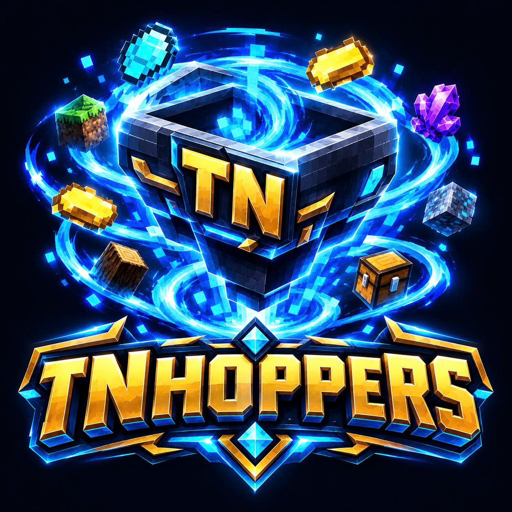

  

# 🚀 Bản Phát Hành TNHoppers v0.6.1 (Gia Cố & Nâng Cấp Độ Bền Vững)

**Phiên bản:** `v0.6.1`  
**Ngày phát hành:** 06/11/2026  
**Tác giả:** Tài Nguyễn (TN)  
**Tương thích:** Paper / Purpur 1.20 - 1.21.x (Java 21+)  

---

### 🛡️ Các cải tiến & gia cố quan trọng trong v0.6.1:
1. **[P0] Chấm dứt ghi đè cấu hình Suction**:
   - Gỡ bỏ hoàn toàn việc ép buộc ghi đè giá trị `suction.enabled`, `interval-ticks`, `respect-item-owner` và `call-pickup-event` khi khởi động.
   - Tôn trọng 100% mọi cấu hình do quản trị viên thiết lập; chỉ bổ sung các tùy chọn còn thiếu.

2. **[P0] Gia cố giao dịch hút item chống Duplicate & Desync**:
   - Cơ chế khấu trừ tức thời (Instant Deduct): Số lượng item trên thế giới được trừ ngay khi mỗi phần đồ được nhận thành công vào rương/phễu.
   - Bắt trọn vẹn ngoại lệ, loại bỏ hoàn toàn khả năng nhân bản vật phẩm khi rương đầy, ngắt quãng hoặc lỗi kết nối.
   - Hỗ trợ kiểm tra quyền sở hữu đồ rơi (`respect-item-owner` kiểm tra cả owner và thrower).

3. **[P1] Tối ưu hóa hiệu năng quét phễu (Performance Cursor)**:
   - Thay thế việc duyệt toàn bộ chunk của mọi thế giới bằng con trỏ ngân sách (Round-Robin Budget Cursor) qua `plugin.cache().snapshotAll()`.
   - Bổ sung cấu hình `transfer.max-hoppers-per-cycle: 512` giúp server hàng nghìn chunk luôn giữ vững 20.0 TPS.

4. **[P1] Khắc phục race-condition khi tải nâng cấp bất đồng bộ**:
   - Đồng bộ hóa việc nạp hồ sơ nâng cấp (`loadUpgradeProfile`) lên luồng chính.
   - Áp dụng `setUpgradesIfAbsent` ngăn việc kết quả nạp database đến muộn ghi đè cấp độ người chơi vừa mua.

5. **[P1] Phân quyền lệnh chuẩn hóa (`tnhoppers.use` & `tnhoppers.admin`)**:
   - Cho phép toàn bộ người chơi thường mở bảng điều khiển `/tnhoppers` hoặc `/tnhoppers menu`.
   - Phân định rõ ràng quyền quản trị `tnhoppers.admin` cho các lệnh lấy đồ, nạp cấu hình và dịch chuyển.

6. **[P1] An toàn dữ liệu SQLite khi Shutdown**:
   - Tăng thời gian chờ đợi ghi cơ sở dữ liệu khi tắt server lên 15 giây.
   - Tự động thực thi `PRAGMA wal_checkpoint(PASSIVE)` đồng bộ sạch nhật ký WAL trước khi ngắt kết nối.

---

# 🚀 Bản Phát Hành TNHoppers v0.6.0 (Release Notes)

**Phiên bản:** `v0.6.0`  
**Ngày phát hành:** 27/10/2026  
**Tác giả:** Tài Nguyễn (TN)  
**Tương thích:** Paper / Purpur 1.20 - 1.21.x (Java 21+)  

---

### 🎉 Các tính năng trong bản phát hành v0.6.0:

1. **Phân loại 2 dòng Hopper chuyên biệt**:
   - **Normal Hopper**: Hút vật phẩm rơi theo bán kính hình cầu (`RADIUS`), có thể nâng cấp bán kính (lên đến 16 block), tốc độ, số lượng và số rương liên kết.
   - **Chunk Hopper**: Hút TOÀN BỘ vật phẩm rơi tự do trong phạm vi cả Chunk (`16x16`), lý tưởng cho các cụm farm quái, farm cây, farm khoáng sản quy mô lớn.
   - Bảo toàn cấp độ & loại phễu khi đập vỡ hoặc bị nổ: Dữ liệu nâng cấp được lưu trực tiếp vào PersistentDataContainer (PDC), rớt ra item giữ nguyên Lore và khôi phục ngay khi đặt lại.

2. **Cấu hình Bộ Lọc Riêng cho Từng Liên Kết (Per-Link Filtering)**:
   - Nhấp chuột trái vào từng rương đích trong menu Links để mở giao diện cấu hình bộ lọc riêng biệt cho rương đó:
     - **Chế độ Whitelist**: Chỉ cho phép các vật phẩm được chỉ định chuyển vào rương này.
     - **Chế độ Blacklist**: Chặn các vật phẩm được chỉ định, cho phép các món khác đi qua.
     - **Lọc nghiêm ngặt (Strict NBT)**: So khớp chính xác cả tên hiển thị, mô tả (lore), phù phép (enchantments), bình thuốc và CustomModelData.
   - **Sao chép & Dán cấu hình (Copy/Paste Filter)**: Nút sao chép cấu hình bộ lọc vào bộ nhớ tạm và dán sang các rương khác chỉ bằng một cú nhấp chuột.
   - **Xóa rác không khớp (Auto-Void Unmatched Items)**: Tùy chọn tự hủy ngay các vật phẩm không khớp với bất kỳ rương đích nào để chống tắc nghẽn phễu và sàn farm.

3. **Điều hướng Chuyển đồ Trực tiếp & Phân phối Thông minh**:
   - Vật phẩm sau khi được hút sẽ được điều hướng truyền thẳng đến các rương đích thỏa điều kiện bộ lọc của từng rương.
   - Chỉ lưu vào phễu nếu tất cả rương đích bị đầy hoặc chưa liên kết rương nào.
   - Nút chuyển đổi trực quan giữa 2 chế độ:
     - `INSERT_BY_ORDER`: Lấp đầy lần lượt từng rương theo thứ tự ưu tiên.
     - `DISTRIBUTE_EQUALLY`: Chia đều luân phiên giữa các rương nhận.

4. **Bảng Điều Khiển & Lệnh Trực Quan `/tnhoppers`**:
   - `/tnhoppers` (hoặc `/tnhoppers menu`): Mở GUI Bảng Điều Khiển Quản Trị Viên:
     - Nhận Normal Hopper / Chunk Hopper.
     - Nhận Gậy Liên Kết (Link Wand).
     - Xem danh sách toàn bộ phễu đang hoạt động trong RAM kèm tính năng nhấp để Dịch chuyển (Teleport).
     - Kiểm tra trạng thái hệ thống và nạp lại cấu hình (Reload).
   - Hỗ trợ Tab-Completion đầy đủ: `/tnhoppers [menu|get <normal|chunk>|wand|reload]`.
   - Mở menu phễu bằng cả Chuột Trái hoặc Chuột Phải (Sneak + Chuột Trái để phá khối).

5. **SuperiorSkyblock2 Protection & SQLite WAL**:
   - Kiểm tra ranh giới đảo, quyền `BUILD` / `CHEST`, chặn liên kết xuyên đảo, bảo vệ thời gian thực.
   - Hàng đợi bất đồng bộ Single-Writer SQLite, cơ chế giao dịch nguyên tử chống dup đồ, cam kết không lag giật TPS.

---

### 📦 Tệp phân phối:
- `TNHoppers-0.6.0.jar`: File plugin shaded hoàn chỉnh (đã tích hợp SQLite JDBC và các thư viện cần thiết).
- `config.yml`: File cấu hình mẫu mặc định.

---

### 💬 Hỗ Trợ & Liên Hệ:
- **Discord:** [https://discord.gg/kwqU3N4nkH](https://discord.gg/kwqU3N4nkH)
- **Gmail:** [tainguyenhr.dev@gmail.com](mailto:tainguyenhr.dev@gmail.com)
