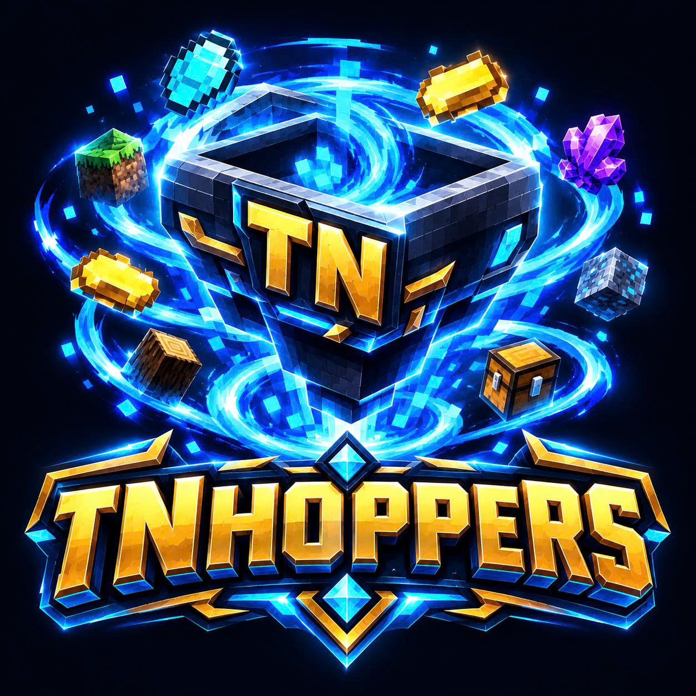

# 📖 TNHoppers Official Wiki Index & Documentation Hub

<p align="center">
  
</p>

> **Tác giả:** Tài Nguyễn (TN)  
> **Phiên bản hiện tại:** `v0.6.2` (Production Ready)  
> **Nền tảng hỗ trợ:** Paper / Purpur 1.20 - 1.21.x (Java 21+)  
> **Kênh hỗ trợ chính thức:** [Discord Server](https://discord.gg/kwqU3N4nkH) | Email: [tainguyenhr.dev@gmail.com](mailto:tainguyenhr.dev@gmail.com)

Chào mừng bạn đến với **Mục Lục Wiki Chính Thức của TNHoppers**! Tài liệu này tổng hợp toàn bộ hướng dẫn, cơ chế vận hành, cấu hình chi tiết và kiến trúc kỹ thuật dành cho người chơi, quản trị viên máy chủ (Server Owner) và nhà phát triển.

---

## 📑 MỤC LỤC TỔNG QUAN (NAVIGATION INDEX)

```
📂 TNHoppers Wiki
├── 📌 1. BẮT ĐẦU NHANH (GETTING STARTED)
│   ├── 1.1 Giới thiệu tổng quan & Triết lý thiết kế
│   ├── 1.2 Yêu cầu hệ thống & Môi trường vận hành
│   ├── 1.3 Hướng dẫn cài đặt từng bước
│   └── 1.4 Khởi động lần đầu & Quy tắc an toàn dữ liệu
│
├── 🌪️ 2. PHÂN LOẠI PHỄU & CƠ CHẾ CỐT LÕI (CORE MECHANICS)
│   ├── 2.1 Phễu Thường (Normal Hopper - Bán kính 3–16 blocks)
│   ├── 2.2 Phễu Chunk (Chunk Hopper - Quét toàn bộ Chunk 16x16)
│   ├── 2.3 Cơ chế bảo toàn cấp độ & Loại phễu (PDC Preservation)
│   └── 2.4 Hút đồ trực tiếp & Chuyển thẳng (Smart Direct Routing)
│
├── 🔗 3. HỆ THỐNG LIÊN KẾT & PHÂN LOẠI THÔNG MINH (WIRELESS & FILTERING)
│   ├── 3.1 Sử dụng Link Wand (Gậy liên kết không dây)
│   ├── 3.2 Chuẩn hóa rương đôi tự động (Double Chest Normalization)
│   ├── 3.3 Điều phối chuyển đồ: Theo thứ tự (Order) vs Chia đều (Equally)
│   ├── 3.4 Tính năng tự hủy rác không khớp (Void Unmatched)
│   ├── 3.5 Cấu hình bộ lọc riêng từng rương (Whitelist & Blacklist)
│   ├── 3.6 So khớp nghiêm ngặt ItemMeta (Strict NBT / Meta Matching)
│   ├── 3.7 Sao chép & Dán nhanh bộ lọc (Filter Clipboard)
│   ├── 3.8 Đổi tên gợi nhớ cho rương đích (Chest Renaming)
│   └── 3.9 Tự Động Phân Loại Đồ Hàng Loạt (Auto-Sorter Wizard - Slot 48)
│
├── ⚡ 4. HỆ THỐNG NÂNG CẤP & KINH TẾ (UPGRADES & ECONOMY)
│   ├── 4.1 Bảng nâng cấp trực quan 4 nhánh chỉ số
│   ├── 4.2 Chi phí nâng cấp & Tích hợp tiền tệ Vault / XP Fallback
│   └── 4.3 Tùy biến công thức giá và mức giới hạn trong config
│
├── 🛡️ 5. BẢO VỆ ĐẢO & KHẢ NĂNG TƯƠNG THÍCH (PROTECTION & INTEGRATIONS)
│   ├── 5.1 Tích hợp SuperiorSkyblock2 (Kiểm tra quyền BUILD & CHEST)
│   ├── 5.2 Chống hút trộm & Chống liên kết xuyên đảo
│   ├── 5.3 Xác thực tư cách thành viên đảo thời gian thực
│   └── 5.4 Chế độ vận hành độc lập (NoOp Protection Adapter)
│
├── ⚙️ 6. CẤU HÌNH, LỆNH & PHÂN QUYỀN (CONFIG, COMMANDS & PERMS)
│   ├── 6.1 Giải thích chi tiết toàn bộ tệp config.yml
│   ├── 6.2 Hệ thống câu lệnh `/tnhoppers` & GUI Control Panel
│   └── 6.3 Bảng phân quyền chi tiết (tnhoppers.use & tnhoppers.admin)
│
├── 🚀 7. KIẾN TRÚC KỸ THUẬT & HIỆU NĂNG CAO (TECHNICAL ARCHITECTURE)
│   ├── 7.1 Bộ đăng ký Live View không cấp phát rác (`activeHoppersView()`)
│   ├── 7.2 Giao dịch hoàn nguyên đối xứng chống dupe (Symmetrical Rollback)
│   ├── 7.3 Con trỏ ngân sách quét phễu (Round-Robin Budget Cursor - 20 TPS)
│   ├── 7.4 SQLite WAL Single-Writer & Cơ chế Checkpoint TRUNCATE
│   └── 7.5 Minh chứng kiểm thử độc lập (27/27 Surefire Unit Tests)
│
├── ❓ 8. KHẮC PHỤC SỰ CỐ & CÂU HỎI THƯỜNG GẶP (TROUBLESHOOTING & FAQ)
│   ├── 8.1 Phễu không hút đồ hoặc rương không nhận đồ
│   ├── 8.2 Rương đích bị đập vỡ hoặc chunk chưa nạp
│   ├── 8.3 Chẩn đoán file WAL của SQLite khi tắt server
│   └── 8.4 Khôi phục dữ liệu phễu sau sự cố crash
│
└── 📜 9. BẢN QUYỀN, HỖ TRỢ & LỘ TRÌNH (COPYRIGHT & ROADMAP)
    ├── 9.1 Bản quyền tác giả độc quyền: Tài Nguyễn (TN)
    ├── 9.2 Kênh liên hệ & Hỗ trợ kỹ thuật
    └── 9.3 Lộ trình phát triển (Folia RegionizedScheduler tại v0.7.0+)
```

---

## 📌 CHƯƠNG 1: BẮT ĐẦU NHANH (GETTING STARTED)

### 1.1 Giới thiệu tổng quan & Triết lý thiết kế
**TNHoppers** là giải pháp phễu không dây thế hệ mới được thiết kế từ đầu bởi **Tài Nguyễn (TN)** nhằm giải quyết triệt để vấn đề sụt giảm TPS và nghẽn luồng do hệ thống đường ống phễu vanilla trên các máy chủ Skyblock, Survival và Towny đông người.
* **Không lag (Zero-Lag):** Thay thế hàng nghìn phễu vanilla bằng thuật toán chuyển đồ theo ngân sách (Budget Cursor).
* **Không rò rỉ bộ nhớ (Zero Memory Leak):** Bộ đệm cache chỉ lưu toạ độ bất biến `BlockPosition`, không giữ tham chiếu tới `World`, `Chunk` hay `Block`.
* **An toàn giao dịch tuyệt đối:** Tính toán sức chứa trước khi chuyển (`simulateInsert`) và hoàn nguyên đối xứng (`insertWithRollback`).

### 1.2 Yêu cầu hệ thống & Phụ thuộc (Dependencies & Requirements)
* **Java:** **Java 21 trở lên** (Khuyến nghị sử dụng [Eclipse Temurin Java 21](https://adoptium.net/temurin/releases/?version=21)).
  > *Lưu ý về Minecraft 1.20:* TNHoppers được lập trình và tối ưu hóa bằng các tính năng mới của Java 21 LTS (Records, Pattern Matching). Mặc dù vanilla 1.20 ban đầu dùng Java 17, các nền tảng Paper/Purpur 1.20 đều hỗ trợ Java 21 toàn diện. Vui lòng đảm bảo máy chủ chạy với Java 21+ JRE.
* **Nền tảng máy chủ:** [Paper](https://papermc.io/downloads/paper), [Purpur](https://purpurmc.org/) hoặc các bản fork tương thích Paper API từ phiên bản **1.20 đến 1.21.x** (dự kiến hỗ trợ Folia tại v0.7.0).
* **Phụ thuộc mềm tùy chọn (Soft Dependencies):**
  * **[Vault](https://www.spigotmc.org/resources/vault.34315/)** (+ plugin kinh tế như EssentialsX): Cho phép người chơi mua nâng cấp phễu bằng tiền trong server. Nếu thiếu Vault, plugin sẽ tự động dùng cấp độ XP thay thế.
  * **[SuperiorSkyblock2](https://bg-software.com/superiorskyblock/)**: Tự động kích hoạt cơ chế bảo vệ đảo nghiêm ngặt (kiểm tra quyền `BUILD` & `CHEST`, chặn chuyển đồ xuyên đảo). Nếu không có, plugin sẽ tự chạy chế độ độc lập (NoOp) cho Survival/SMP.

### 1.3 Hướng dẫn cài đặt
1. Tải bản phát hành chính thức `TNHoppers-0.6.2.jar` từ **[GitHub Releases](https://github.com/Jaojao00/TNHoppers/releases)**.
2. Đặt file `.jar` vào thư mục `plugins/` của máy chủ.
3. Khởi động lại máy chủ (Restart) để plugin tự động tạo cơ sở dữ liệu `tnhoppers.db` và tệp `config.yml`.

---

## 🌪️ CHƯƠNG 2: PHÂN LOẠI PHỄU & CƠ CHẾ CỐT LÕI

### 2.1 Phân loại phễu & Cơ chế Bán kính
* 🔸 **Normal Hopper (Phễu Thường):** Hút vật phẩm rơi tự do theo hình cầu (`RADIUS`). Bán kính mặc định là **5 blocks** (tránh hút lan ra ngoài nhà khi đứng xa) và có thể nâng cấp mở rộng lên tới **24 blocks** (Cấp 1: 5b, Cấp 2: 8b, Cấp 3: 12b, Cấp 4: 16b, Cấp 5: 24b). Người chơi có thể dùng nút **La Bàn (Slot 21)** trong menu để tự do tăng/giảm bán kính hút theo ý muốn!
* 🔹 **Chunk Hopper (Phễu Chunk):** Hút **TOÀN BỘ** vật phẩm rơi tự do trong phạm vi toàn bộ 1 Chunk (`16x16` từ tầng bedrock đến nóc thế giới). Phù hợp cho cụm farm quái lớn, farm đá đỏ, máy thu hoạch quy mô lớn. Cho phép cài đặt giới hạn bán kính trong GUI.
* 🛡️ **Bảo vệ đồ người chơi tự vứt (Player Drop Protection):** Khi người chơi tự bấm Q vứt đồ, phễu sẽ chờ hết 2 giây trễ nhặt (40 ticks) mới hút. Đồ từ quái chết hoặc nông sản gãy vẫn được hút tức thì không độ trễ.

### 2.2 Bảo toàn cấp độ & Loại phễu (PDC Preservation)
* Khi phễu bị đập vỡ bằng cúp hoặc bị nổ bởi TNT/Creeper, phễu rơi ra vật phẩm đặc biệt lưu toàn bộ cấp độ nâng cấp và loại phễu trong `PersistentDataContainer (PDC)`.
* Khi đặt lại khối phễu xuống đất, toàn bộ cấp độ (Tốc độ, Số lượng, Liên kết, Bán kính) được khôi phục nguyên vẹn 100%.

### 2.3 Thao tác tương tác
* **Mở Menu quản lý:** Nhấp chuột trái HOẶC chuột phải vào phễu.
* **Đập vỡ phễu:** **Sneak (Ngồi xổm) + Chuột trái**.

---

## 🔗 CHƯƠNG 3: HỆ THỐNG LIÊN KẾT & PHÂN LOẠI THÔNG MINH

### 3.1 Quy trình tạo liên kết bằng Link Wand
1. Gõ `/tnhoppers wand` để nhận **Link Wand**.
2. Nhấp chuột phải vào phễu TNHoppers nguồn.
3. Nhấp chuột phải vào thùng chứa đích (Rương, Shulker, Thùng gỗ...).
4. Hệ thống tự động chuẩn hóa rương đôi và kiểm tra giới hạn khoảng cách/số lượng.

### 3.2 Cấu hình bộ lọc riêng cho từng rương (Per-Link Filtering)
Trong menu **Liên kết (Links)** của phễu:
* 🖱️ **Chuột TRÁI vào rương đích:** Mở giao diện cài đặt bộ lọc riêng.
  * **Whitelist:** Chỉ cho phép các món đồ mẫu chuyển vào rương này.
  * **Blacklist:** Chặn các món đồ mẫu, cho phép mọi đồ khác đi vào.
  * **Strict Matching:** So khớp chính xác ItemMeta (tên, lore, enchant, potion).
  * 📋 **Sao chép / Dán bộ lọc:** Chép bộ lọc từ rương này sang rương khác chỉ bằng 1 cú nhấp.
* 🖱️ **Chuột PHẢI vào rương đích:** Gỡ liên kết rương an toàn.

### 3.3 Điều phối chuyển đồ & Tự hủy rác
* **Chế độ chuyển đồ (Slot 45):**
  * `INSERT_BY_ORDER`: Lấp đầy rương đích ưu tiên trước khi sang rương tiếp theo.
  * `DISTRIBUTE_EQUALLY`: Chia đều luân phiên xoay vòng cho tất cả các rương.
* **Tự hủy rác không khớp (Slot 46 - Void Unmatched):** Tự động xóa các vật phẩm không khớp bất kỳ rương đích nào để chống nghẹt sàn farm.

### 3.4 Tự Động Phân Loại Đồ Hàng Loạt (Auto-Sorter Wizard - Slot 48)
* **Vị trí:** Slot 48 trong menu Liên kết (Biểu tượng Xe mỏ phễu `HOPPER_MINECART`).
* **Cách sử dụng:**
  1. Người chơi chuẩn bị các món đồ mẫu trong túi đồ (ưu tiên đặt vào thanh Hotbar 1–9).
  2. **Chuột TRÁI:** Tự động gán bộ lọc **Whitelist** cho từng rương theo thứ tự món đồ.
  3. **Chuột PHẢI:** Tự động gán bộ lọc **Blacklist** cho từng rương.
  4. Hệ thống **tự động đổi tên từng rương** theo tên tiếng Việt thân thiện của món đồ tương ứng (`§fSắt Thô`, `§9Lapis Lazuli`, `§bKim Cương`...).
* **Bảo vệ an toàn:**
  * 100% Read-Only: Túi đồ của người chơi được giữ nguyên vẹn.
  * Chống ghi đè vô ý: Nếu rương đã có bộ lọc từ trước, hệ thống yêu cầu nhấp xác nhận lần thứ hai trong 10 giây.
  * Phân biệt ItemMeta đa chiều: Tự động bật `strict = true` khi đồ mẫu có enchant, potion, lore hoặc custom name.
  * Rollback tức thời: Nếu lưu database SQLite gặp lỗi, cache RAM lập tức hoàn tác về cấu hình ban đầu.

### 3.5 Lớp Bảo Vệ Phá Hủy & Chống Nổ (Break & Explosion Protection)
* **Khóa phá hủy rương đích liên kết:** Rương/thùng chứa đang được liên kết với phễu TNHoppers không thể bị phá bởi bất kỳ người chơi nào. Khi cố phá, sự kiện `BlockBreakEvent` bị hủy ngay lập tức, phát âm thanh cảnh báo lỗi và yêu cầu gỡ liên kết trước trong menu phễu.
* **Chuẩn hóa rương đôi (Double Chest Normalization):** Nhận diện chính xác cả nửa trái và nửa phải của rương đôi. Đập vào bất kỳ nửa nào cũng được bảo vệ an toàn.
* **Khóa phá hủy phễu TNHoppers:** Phễu đang có liên kết rương đích sẽ không thể bị phá cho đến khi toàn bộ liên kết được gỡ bỏ trong GUI.
* **Miễn nhiễm nổ 100%:** Cả phễu và rương liên kết đều được lọc ra khỏi danh sách khối bị phá hủy của TNT, Creeper, Wither và Ender Dragon trong `ExplosionCleanupListener`.

---

## ⚡ CHƯƠNG 4: HỆ THỐNG NÂNG CẤP & KHO ẢO (UPGRADES & DEEP STORAGE)

| Nhánh nâng cấp | Biểu tượng | Tác dụng | Giới hạn |
| :--- | :---: | :--- | :---: |
| **Tốc độ (Speed)** | ⚡ | Giảm thời gian trễ giữa các lần chuyển (từ 20 ticks xuống 15, 10, 5, 2 ticks) | Cấp 5 |
| **Số lượng (Amount)** | 📦 | Tăng số item chuyển mỗi lần (từ 1 lên 4, 16, 32, 64 items) | Cấp 5 |
| **Dung tích Kho Ảo (Deep Storage)** | 🛢️ | Sức chứa bộ đệm ảo khi rương đầy (từ 10,000 lên 50,000, 100,000, 250,000 items) | Cấp 4 |
| **Số liên kết (Links)** | 🔗 | Mở rộng số lượng rương kết nối cùng lúc (từ 1 lên 3, 5, 8, 15 rương) | Cấp 5 |
| **Bán kính / Khoảng cách** | 📏 | Tăng bán kính hút đồ rơi (lên tới 16 blocks) và khoảng cách liên kết (250 blocks) | Cấp 5 |

* Người chơi thanh toán bằng tiền tệ Vault. Nếu server không có Vault, hệ thống tự động chuyển sang sử dụng cấp độ kinh nghiệm (XP Levels).

### 4.4 Kho Lưu Trữ Ảo Mở Rộng (Virtual Deep Storage — Option 2)
* **Khái niệm:** Khi rương vật lý liên kết đầy 100%, đồ hút hoặc chuyển đến sẽ không bị nghẹt mà tự động tràn vào bộ đệm ảo (Deep Storage).
* **4 Mốc nâng cấp:**
  * **Cấp 1:** `10,000` items (Mặc định khi tạo liên kết)
  * **Cấp 2:** `50,000` items ($5,000 Vault / XP)
  * **Cấp 3:** `100,000` items ($15,000 Vault / XP)
  * **Cấp 4:** `250,000` items ($50,000 Vault / XP — Cấp tối đa)
* **Tự động xả vào rương (Auto-Drain):** Khi có ô trống trong rương vật lý, phễu tự động xả mượt các item trong kho ảo vào rương theo chu kỳ tick.
* **Trình xem & Rút đồ từ Kho Ảo (Deep Storage Viewer):**
  * Nhấp giữa chuột (Middle-click) vào rương liên kết trong menu Links, hoặc bấm nút Kho Ảo (Slot 47) trong menu Bộ lọc.
  * Xem danh sách các món đồ và số lượng thực tế đang lưu trong kho ảo.
  * **Chuột TRÁI:** Rút 1 Stack (64 items) vào túi đồ.
  * **Chuột PHẢI:** Rút 1 item.
  * **Shift + Click:** Rút toàn bộ số lượng vào túi đồ.
  * **Nút "Xả Vào Rương Ngay" (Slot 53):** Ép xả đồ vào rương vật lý ngay lập tức nếu rương có ô trống.
* **Chống mất đồ khi hủy liên kết:** Không cho phép hủy liên kết nếu kho ảo của rương đó còn chứa vật phẩm.
* **Lưu trữ SQLite WAL (`hopper_virtual_storage`):** Dữ liệu được lưu vĩnh viễn và an toàn tuyệt đối 100% qua restart server hoặc dỡ nạp chunk.

---

## 🛡️ CHƯƠNG 5: BẢO VỆ ĐẢO (SUPERIORSKYBLOCK2)

* **Bảo vệ toàn diện:** Bắt buộc người chơi phải có quyền `BUILD` tại vị trí phễu và quyền `CHEST` tại vị trí rương đích.
* **Cấm liên kết xuyên đảo:** Ngăn chặn triệt để hành vi nối phễu từ đảo này sang đảo khác để hút trộm tài nguyên.
* **Xác thực thành viên thời gian thực:** Nếu người chơi bị đuổi (kick/ban) khỏi đảo, toàn bộ phễu của người đó trên đảo sẽ lập tức ngừng hoạt động.

---

## ⚙️ CHƯƠNG 6: CÂU LỆNH & PHÂN QUYỀN

### Danh sách câu lệnh
* `/tnhoppers`: Mở Bảng Điều Khiển Tổng Quan (GUI Control Panel).
* `/tnhoppers get <normal|chunk>`: Lấy phễu không dây TNHoppers.
* `/tnhoppers wand`: Lấy gậy liên kết Link Wand.
* `/tnhoppers reload`: Nạp lại toàn bộ tệp cấu hình `config.yml`.

### Bảng phân quyền (Permissions)
* `tnhoppers.use` (Mặc định: `true` cho mọi người): Quyền mở menu `/tnhoppers` và sử dụng phễu của mình.
* `tnhoppers.admin` (Mặc định: `op`): Quyền nhận phễu/wand, dịch chuyển đến phễu kiểm tra và nạp lại plugin.

---

## 🚀 CHƯƠNG 7: KIẾN TRÚC KỸ THUẬT & HIỆU NĂNG CAO

* **Live View Registry (`activeHoppersView()`):** Duy trì chỉ mục kép phẳng `ConcurrentHashMap<BlockPosition, HopperData>`. Chi phí cấp phát = 0 allocation, con trỏ ngân sách duyệt an toàn không bị `ConcurrentModificationException`.
* **Giao dịch Hoàn nguyên Đối xứng (Symmetrical Rollback):** Lưu trữ snapshot kho chứa và trạng thái thực thể ngoài thế giới. Nếu có ngoại lệ, cả kho chứa lẫn thực thể thế giới đều được khôi phục nguyên trạng.
* **SQLite WAL Single-Writer:** Thực thi trên luồng ghi duy nhất, chế độ WAL với timeout 5000ms. Khi tắt máy chủ, chạy `PRAGMA wal_checkpoint(TRUNCATE)` kèm kiểm tra mã chẩn đoán `busy/log/checkpointed`.
* **27 Unit Tests Độc Lập:** Bộ kiểm thử tự động xác minh tính bảo toàn khối lượng, cơ chế bảo vệ phá hủy rương, phân cấp bán kính hút (5, 8, 12, 16, 24 blocks) kèm khả năng tùy chỉnh bán kính, và 4 mốc sức chứa kho ảo Deep Storage (10k, 50k, 100k, 250k items) đạt tỷ lệ vượt qua 100%.

---

## ❓ CHƯƠNG 8: KHẮC PHỤC SỰ CỐ & CÂU HỎI THƯỜNG GẶP (FAQ)

### Q1: Phễu không tự hút đồ rơi trên sàn?
* **Khắc phục:** Mở `config.yml`, kiểm tra `suction.enabled: true`. Đảm bảo bán kính `suction.radius` đủ bao quát khu vực farm. Nếu vật phẩm do người chơi khác vứt ra, kiểm tra tùy chọn `suction.respect-item-owner`.

### Q2: Rương liên kết bị đập vỡ thì phễu có bị lỗi không?
* **Khắc phục:** Không. Plugin tự động lắng nghe sự kiện phá khối, tự động gỡ bỏ liên kết đích bị phá khỏi database và cache trong RAM, chống hoàn toàn lỗi NullPointer.

### Q3: Tệp `tnhoppers.db-wal` vẫn còn tồn tại sau khi tắt server?
* **Khắc phục:** Đây là cơ chế hoàn toàn bình thường của SQLite nếu có luồng đọc đóng chậm hơn vài mili-giây. Toàn bộ dữ liệu trong file `-wal` sẽ được SQLite tự động nạp và khôi phục sạch sẽ khi server khởi động lại. Tuyệt đối không xóa thủ công file `-wal`.

---

## 📜 CHƯƠNG 9: BẢN QUYỀN & HỖ TRỢ

* **Bản quyền tác phẩm:** Toàn bộ mã nguồn, thiết kế và tài liệu thuộc bản quyền độc quyền của **Tài Nguyễn (TN)**.
* **Kênh hỗ trợ chính thức:**
  * 💬 **Discord Community:** [https://discord.gg/kwqU3N4nkH](https://discord.gg/kwqU3N4nkH)
  * 📧 **Email:** [tainguyenhr.dev@gmail.com](mailto:tainguyenhr.dev@gmail.com)
  * 🌐 **Tải phiên bản mới nhất:** [GitHub Releases](https://github.com/Jaojao00/TNHoppers/releases)
